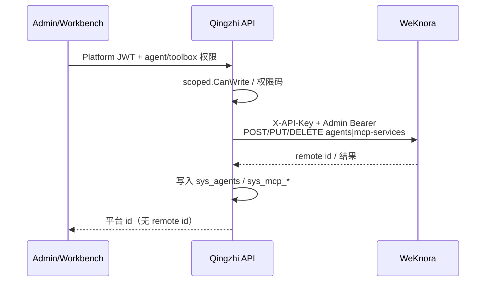
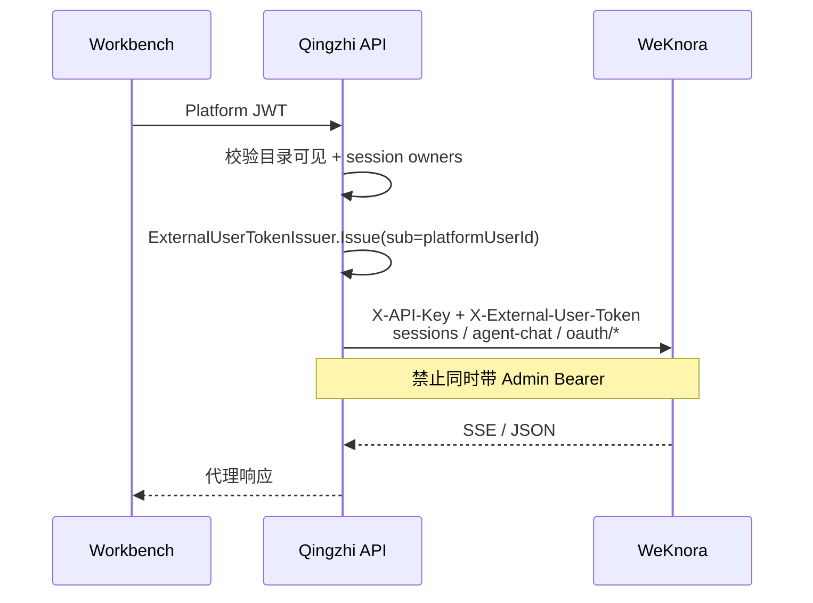

# Agent / MCP 第一阶段：能力盘点与实施报告

> 范围：只读代码盘点 + 线上 WeKnora 探测结论。**不改**业务代码、迁移、菜单或前端。  
> 探测目标：`.env` 中 `WEKNORA_BASE_URL`（本轮为 `http://192.168.0.167:8083`，空间 `tenant_id=10000`，`api-principal-config.mode=signed_token`）。  
> 探测脚本（默认不读入密钥到仓库输出）：`scripts/agent-mcp-phase1-probe.go`、`probe2.go`、`probe3.go`。

---

## 1. 现有 Qingzhi API / 代码清单

### 1.1 三层鉴权（已具备，用法分裂）

| 层 | 头 / 机制 | 代码 | 当前用途 |
| --- | --- | --- | --- |
| Workspace API Key | `X-API-Key` | `weknora.HTTPClient.Configure` / SDK | 所有 WeKnora 调用的空间钥匙 |
| Admin JWT | `Authorization: Bearer` | `EnsureAdminAuth`、`ExchangeAdmin`、`exchangeWithBearer`（`client.go` / `admin_auth.go`） | Agent/MCP CRUD、模型、记忆配置、系统信息 |
| External User Token | `X-External-User-Token` | `usertoken.go`（`ExternalUserTokenIssuer.Issue`）、`external_header.go`（ctx 注入） | Chat session、个人记忆；**禁止**与 Admin Bearer 混用同一会话路径（见 `rebuildLocked` 注释） |
| Principal 模式 | `PUT/GET .../api-principal-config` | `EnsureSignedTokenPrincipal`（`admin_auth.go`）、`settings.Service.EnsureSignedTokenPrincipal` | 空间固定为 `signed_token` |

说明：`client.go` 明确 Admin JWT **仅**走 `ExchangeAdmin`；共享 SDK 客户端只带 API Key + 可选 External Token，避免会话被记到管理员主体导致后续 Ask 404。

### 1.2 WeKnora 客户端已封装

**Agent**（`internal/weknora/agents.go`，全部 `ExchangeAdmin`）

| 函数 | 远端 |
| --- | --- |
| `CreateRemoteAgent` | `POST /api/v1/agents` |
| `GetRemoteAgent` | `GET /api/v1/agents/{id}` |
| `UpdateRemoteAgent` | `PUT /api/v1/agents/{id}` |
| `DeleteRemoteAgent` | `DELETE /api/v1/agents/{id}` |

未封装：`List`、`PATCH`、`POST .../copy`、按 `creator=mine` 过滤。

**MCP**（`internal/weknora/mcp.go`，全部 `ExchangeAdmin`）

| 函数 | 远端 |
| --- | --- |
| `CreateRemoteMCPService` | `POST /api/v1/mcp-services` |
| `UpdateRemoteMCPService` | `PUT /api/v1/mcp-services/{id}` |
| `DeleteRemoteMCPService` | `DELETE /api/v1/mcp-services/{id}` |
| `TestRemoteMCPService` | `POST /api/v1/mcp-services/{id}/test` |

未封装：tools / metadata / refresh、credentials、oauth（status / authorize-url / revoke）、tool-approvals、工具启停。

**Chat**（`internal/weknora/chat_client.go` + `internal/chat/service.go`）

- Session CRUD / 消息：API Key + External Token（SDK）。
- Ask：无绑定 → `OpenKnowledgeChatStream` + `agent_enabled=false`；有 `chat_session_owners.agent_id` → `OpenAgentChatStream`（`/agent-chat/{session_id}`），先经目录可见性解析 `weknora_agent_id`。
- 会话 ACL 真相：`chat_session_owners`（`000028` + `000034` 的 `agent_id`），非 WeKnora 跨用户隔离。

**产物**（`artifacts.go`）：Admin 列表/删除走 `ExchangeAdmin`；用户面走 External Token。

### 1.3 平台目录（Catalog）

| 层 | 路径 / 表 | 要点 |
| --- | --- | --- |
| HTTP | `handler/catalog.go`：`GET/POST/DELETE /agents`、`/toolbox/mcp`、`POST .../test`；产物 admin/user | 权限 `agent:*` / `toolbox:*` / `artifact:*` |
| 领域 | `catalog.Service`：`ListAgents` / `CreateAgent` / `DeleteAgent`；MCP 同构 | 可见性 `scoped.CanView` / `CanWrite`；响应抹掉 `RemoteID` |
| 表 | `sys_agents`、`sys_agent_tenants`、`sys_agent_shares`；`sys_mcp_services`、`sys_mcp_service_tenants`、`sys_mcp_service_shares`（`000030`） | `scope_type ∈ {personal,tenant,org_node,role}`；存 `weknora_*_id`，不下发前端 |
| 远端写入 | 创建时调 Admin 封装；失败回滚删远端 | 当前无 Update 平台 API；无 OAuth / tools 代理 |

### 1.4 平台对外 API（已有）

- `GET/POST /api/v1/agents`、`DELETE /api/v1/agents/{id}`
- `GET/POST /api/v1/toolbox/mcp`、`DELETE .../{id}`、`POST .../{id}/test`
- `GET/DELETE /api/v1/artifacts` 与 `/admin/artifacts`
- Chat：`/api/v1/chat/sessions*`、Ask/Stop（knowledge-chat，agent 关闭）

---

## 2. WeKnora 已验证 API 清单

鉴权列：`Admin` = API Key + Admin Bearer；`Ext` = API Key + `X-External-User-Token`；`Admin+Ext` = 二者同时带。

### 2.1 Agent

| 方法 | 路径 | 鉴权 | 实测 |
| --- | --- | --- | --- |
| GET | `/api/v1/agents` | Admin / Ext | **200**；空间内全量（含 builtin），Ext 与 Admin 列表等价可见 |
| GET | `/api/v1/agents?creator=mine` | Admin | **200**；仍含 builtin；自定义条目按 Admin 用户 `created_by` 过滤语义存在，但 **不按 External `sub` 过滤** |
| POST | `/api/v1/agents` | Admin | **201**；`created_by` = WeKnora 管理员用户 UUID |
| POST | `/api/v1/agents` | Ext（仅 API Key + Token） | **201**；`created_by` **仍为管理员 UUID**，不是 `probe-user-a` |
| POST | `/api/v1/agents` | Admin+Ext | **201**；`created_by` 仍为管理员 UUID |
| GET | `/api/v1/agents/{id}` | Admin / Ext | **200** |
| PATCH | `/api/v1/agents/{id}` | Admin | **404** page not found（无 PATCH） |
| PUT | `/api/v1/agents/{id}` | Admin | **200** |
| POST | `/api/v1/agents/{id}/copy` | Admin | **201**；副本名带「（副本）」；`created_by` 同管理员 |
| DELETE | `/api/v1/agents/{id}` | Ext（任意 probe 用户） | **200**；用户 B 可删用户 A「创建」的 Agent |
| DELETE | `/api/v1/agents/{id}` | Admin | **200**（存在时） |

**结论（实测）**：Agent 所有权挂在 WeKnora **租户管理员账号**，**不**绑定 External Principal；API Key 持有者即可对空间内 Agent 做读写删。`signed_token` **不参与** Agent ACL。

### 2.2 MCP

| 方法 | 路径 | 鉴权 | 实测 |
| --- | --- | --- | --- |
| GET | `/api/v1/mcp-services` | Admin / Ext | **200**；空间级列表，无 per-user 过滤 |
| POST | `/api/v1/mcp-services` | Admin | **200** |
| GET | `/api/v1/mcp-services/{id}` | Admin | **200** |
| POST | `.../test` | Admin | **200**（body 内 `success` 可为 false） |
| GET | `.../tools` | Admin / Ext | 路径存在；假 URL 时 **500**（连不上上游） |
| GET | `.../metadata` | Admin | **200**（可为 null） |
| POST | `.../metadata/refresh` | Admin / Ext | 路径存在；连不上时 **400** |
| POST | `.../sync` | Admin | **404**（无此路径） |
| GET | `.../oauth/status` | Admin / Ext | **200**；`authorized` / `state` / `refresh_available` |
| POST | `.../oauth/authorize` | — | **404**（错误路径） |
| POST | `.../oauth/authorize-url` | Ext | 路径正确；非 OAuth 配置服务返回 **400** `MCP service is not configured to use OAuth` |
| GET | `.../oauth/token` | — | **404** |
| DELETE | `.../oauth/token` | Ext | **204**（撤销当前主体 token） |
| PUT | `.../credentials` | Ext | **200**（可写 `api_key` 等字段状态）；**危险**：用户面 Token 也能改共享凭证 → 必须由 Qingzhi 闸门 |
| GET | `.../tool-approvals` | Ext | **200** |
| DELETE | `/api/v1/mcp-services/{id}` | Admin | **200** |

官方文档对齐：OAuth 发起为 `POST .../oauth/authorize-url`（Viewer+），非 `authorize`。

### 2.3 Chat / Session / Principal

| 方法 | 路径 | 鉴权 | 实测 |
| --- | --- | --- | --- |
| POST | `/api/v1/sessions` | Ext | **201**；`user_id=api_external_user:{tenant}:{sub}` |
| POST | `/api/v1/agent-chat/{session_id}` | Ext | **200** SSE（`response_type=agent_query`） |
| POST | `/api/v1/knowledge-chat/{session_id}` + `agent_enabled=true` | Ext | **200** SSE |
| GET | `/api/v1/sessions/{id}`（A 创建，B 读） | Ext B | **200**（能读到 A 的 session 元数据） |
| GET | `/api/v1/tenants/{id}/api-principal-config` | Admin | **200**；`mode=signed_token`，`has_hmac_secret=true` |

**结论**：上游已有 **agent-chat** 与 knowledge-chat 开 Agent；会话在 WeKnora 侧 **不能**依赖跨用户拒绝，平台必须继续用 `sys_chat_session_owners`（与现网 Chat 一致）。

---

## 3. 已有能力 vs 缺失能力

| 能力 | Qingzhi 现状 | WeKnora 上游 | 缺口 |
| --- | --- | --- | --- |
| Agent CRUD 目录 + 作用域可见性 | 有（`sys_agents` + scoped） | 有 CRUD/copy；无可靠 per-user ACL | 平台 Update/列表远端同步；copy 未封装；**ACL 只能信平台** |
| Agent 对话 | 关闭（`AgentEnabled: false`） | `agent-chat` / `agent_enabled` 可用 | 未接通；无 agent 选择与绑定 |
| MCP 注册 / test | 有 | 有 | tools/metadata/credentials/OAuth/approvals 未代理 |
| MCP OAuth per-user | 无 | authorize-url / status / revoke token | 未封装；需用户面 Ext Token |
| MCP 共享静态凭证 | 创建时可带 headers；无保险库 | `PUT credentials` | 管理面闸门缺失（探测显示 Ext 也能写） |
| 个人静态 API Key Gateway | 无 | N/A | **本期明确不做** |
| 身份调用统一 | 分裂：Catalog=Admin，Chat=Ext | 三层都可用 | 缺统一「管理面 vs 用户面」调用约定与辅助函数 |
| Session 隔离 | 平台 owners 表 | 跨 Ext 用户 GET 仍 200 | 已有模式可复用；Agent 会话同样必须走平台表 |

---

## 4. 职责划分（Qingzhi vs WeKnora）终稿建议

| 职责 | Qingzhi（真相 / 闸门） | WeKnora（执行面） |
| --- | --- | --- |
| 谁可见 / 谁可管 Agent、MCP | `sys_*` + `scoped` + 权限码 | 不作为企业 ACL |
| 远端实体生命周期 | 通过 Admin JWT 代理创建/更新/删除/copy/test | 存储 Agent/MCP 定义与运行时 |
| 终端用户对话、记忆、OAuth 授权态 | 签发 External Token；校验平台会话归属与目录可见性后再转发 | 按 principal 执行 agent-chat / MCP OAuth token |
| 共享 MCP 静态密钥 | 仅管理端可写；密钥不下发前端 | 保存并调用上游 MCP |
| `user_oauth` MCP | 平台记录「该 MCP 需用户授权」；代理 authorize-url / status / revoke | 按 External principal 存 OAuth token |
| 会话列表与越权 | `sys_chat_session_owners`（及后续 agent 会话若分离则同模式） | 提供 session/chat API，**不**当 ACL |

**一句话**：Qingzhi bindings（目录 + 权限 + 会话归属）为 ACL 真相；WeKnora 为执行面与配置存储。

---

## 5. 身份传递时序图

### 5.1 管理面（Agent / MCP 定义 CRUD）

### 5.2 用户面（对话 / OAuth / 个人记忆）

---

## 6. Agent ownership 结论与 bindings 策略

### 6.1 结论（确定）

1. **`signed_token` / External Principal 不参与 WeKnora Agent ACL。**  
   证据：Ext 创建仍 `created_by=admin`；任意 Ext 用户可 DELETE；列表对 Ext 与 Admin 同等暴露空间内 Agent。
2. **不能**用 `creator=mine` 表达企业「我的智能体」——mine 指向 WeKnora 管理员，不是平台用户。
3. **默认实施策略**：Qingzhi `sys_agents`（+ tenants/shares + scope）为唯一 ACL；WeKnora Agent 仅作运行配置。管理写操作一律 `ExchangeAdmin`；用户只读目录走平台表，执行对话走 Ext Token + 平台校验后的 remote id（服务端解析，不下发）。

### 6.2 Bindings 策略

- 继续演进 `sys_agents` / `sys_agent_tenants` / `sys_agent_shares`，**不**新建平行 `qz_agents` 目录。
- 建议字段增量（本阶段不落迁移，供后续）：
  - `config_json` 或托管关键配置摘要（模型/KB/MCP 选择模式），避免每次 UI 直打 WeKnora。
  - `weknora_created_by`（可选审计，记管理员 UUID）。
  - 对话绑定：会话侧增加 `agent_id`（平台 UUID）列或扩展 owners 表，Ask 时解析 `weknora_agent_id`。
- Copy：平台「另存」= 远端 `POST .../copy` + 新 `sys_agents` 行（新 scope/creator）。

---

## 7. MCP `shared` 静态凭证 vs `user_oauth` per-principal

### 7.1 结论（确定）

| 模式 | 含义 | 谁持有密钥 | Qingzhi 闸门 |
| --- | --- | --- | --- |
| **shared** | 租户/组织级 MCP，静态 Header / API Key / Token | WeKnora `credentials`（空间级） | **仅管理面** Admin 代理 `PUT/DELETE credentials`；目录 `CanWrite`；**禁止**用户 Ext 直打（探测已证明 Ext 可写） |
| **user_oauth** | 同一 MCP 定义，每用户 OAuth | WeKnora 按 principal 存 token（status / authorize-url / DELETE token） | 用户面 Ext 代理；平台先 `CanView`；授权态可缓存展示，真相在 WK status |
| **个人静态 API Key Gateway** | 每用户自备上游 Key 的保险库 | — | **本期不做**（不建凭证保险库表、不做个人 Gateway） |

### 7.2 目录字段建议（演进 `sys_mcp_services`）

- `auth_mode`：`shared` | `user_oauth`（默认 `shared`）。
- `oauth_ready` / 展示用缓存可选；不以平台库存 OAuth refresh token。
- 保留现有 scope / tenants / shares；**不做**工具审批（tool-approvals）平台代理；启停若需在 WeKnora 控制台处理。

---

## 8. 与现有 `sys_*` 目录的演进方案

**原则：演进现有表，避免平行双目录。**

| 对象 | 建议 |
| --- | --- |
| `sys_agents` | 增加配置快照、可选 `default_for_chat`；Update API；删除时同步远端 |
| `sys_mcp_services` | 增加 `auth_mode`、URL/transport 已有；管理 API：credentials、test、tools 元数据刷新 |
| shares / tenants | 保持与知识库同构的 scoped 模型 |
| 新表（仅必要时） | `sys_chat_session_owners` 扩展 `agent_id`；**不**为 OAuth token 建镜像表 |
| 远端 id | 继续仅存服务端，响应不暴露 |

---

## 9. 风险清单与第二～六阶段实施顺序

### 9.1 风险

| 风险 | 影响 | 缓解 |
| --- | --- | --- |
| WeKnora Agent/MCP 无企业用户 ACL | 持 API Key 即可改删全空间实体 | 所有写操作经 Qingzhi；密钥不进前端；禁止用户面代理危险写（credentials/delete agent） |
| Ext 可写 MCP credentials | 共享密钥被普通用户覆盖 | 管理面专用封装；用户路由不暴露 |
| Session GET 跨用户 200 | 直连 WK 会串会话 | 强制平台 owners；不把 WK session API 暴露给浏览器 |
| Admin Bearer 混入 Chat | 会话归属错乱 / Ask 404 | 维持 ExchangeAdmin 与用户 Exchange 分离 |
| 过早打开 `agent_enabled` | 未绑 Agent/MCP 策略的生产流量 | 无绑定仍 `false`；第五阶段仅会话显式绑定平台 agent 才走 agent-chat |
| OAuth 回调域名 / redirect_uri | 授权失败 | 平台统一回调入口再换 Ext 调 WK |

### 9.2 阶段顺序（仅规划）

| 阶段 | 内容 |
| --- | --- |
| **二** | 身份调用封装统一：管理面 `ExchangeAdmin` vs 用户面 `Exchange`+Token 规则；禁止混用清单；Catalog/Chat 辅助函数收敛 |
| **三** | ~~管理端 Agent/MCP 增强~~（2026-11-03）：Update/copy、MCP credentials（shared）、metadata refresh；迁移 `000033` |
| **四** | ~~Workbench user_oauth~~（2026-11-03）：平台代理 status/authorize-url/revoke；回调仍在 WeKnora；工作台授权/撤销 UI |
| **五** | ~~对话接通~~（2026-11-03）：`000034` owners.`agent_id`；CreateSession 可选绑定；Ask → `OpenAgentChatStream`；工作台可选智能体 |
| **六** | ~~硬化~~（2026-11-03）：操作审计模块映射；WeKnora 连通性监控；**不做**工具审批代理 / 个人 API Key Gateway；文档与验收回归 |
| **七** | ~~智能体配置编辑~~（2026-11-03）：提示词 / 模式 / Wiki 类型、平台知识库与 MCP（全部可见 / 指定）绑定、联网与记忆开关；KB 禁 `all`，MCP `all` 展开为可见列表 |

### 9.3 第二阶段最小开工清单

> **状态（2026-11-03）**：已落地。矩阵见 [weknora-call-planes.md](weknora-call-planes.md)；封装与 `AssertUserPlaneAllowed` / `ExchangeUser` 见 `internal/weknora`；Catalog `auth_mode` 常量默认 `shared`（未落库）。

1. ~~文档化并代码化「管理面 / 用户面」矩阵~~ → `docs/weknora-call-planes.md` + `call_plane.go`  
2. ~~薄封装~~ → `ListRemoteAgents`、`CopyRemoteAgent`、`GetRemoteMCPOAuthStatus`、`CreateRemoteMCPAuthorizeURL`、`RevokeRemoteMCPOAuthToken`、`PutRemoteMCPCredentials`、`DeleteRemoteMCPCredential`  
3. ~~用户面拦截~~ → `Exchange` / `ExchangeUser` 调用前 `AssertUserPlaneAllowed`（拒绝对 Agent/MCP 定义写与 credentials）  
4. ~~Catalog `auth_mode` 预留~~ → `catalog.NormalizeMCPAuthMode` / `Item.AuthMode`（默认 shared，无迁移）  
5. ~~契约测试~~ → `call_plane_test.go`

---

## 10. 验收标准草案（供后续阶段）

### 10.1 安全 / 隔离

- [x] 浏览器永不持有 WeKnora API Key、Admin 密码、HMAC、MCP 静态密钥、remote agent/mcp id。  
- [x] 用户 A 不可通过平台 API 删除/修改不可见 Agent/MCP；不可读写 B 的 chat session（owners + CanView）。  
- [x] 即使用户拿到 Ext Token，平台也不提供「代理删除空间内任意 Agent / 改 shared credentials / tool-approvals」的路由。  
- [x] Chat Ask 路径永不附带 Admin Bearer。

### 10.2 功能

- [x] 管理端可完成 Agent PUT/copy 与 MCP shared 凭证配置，并回写 `sys_*`。  
- [x] `user_oauth` MCP：用户可完成 authorize-url → callback → status=authorized；revoke 后 status 更新。  
- [x] Workbench 仅列出 `CanView` 的 Agent/MCP；对话可选平台 Agent 并走 `agent-chat`（会话绑定）。  
- [x] 无绑定会话 Ask 仍 `agent_enabled=false`；绑定后走 agent-chat 并校验目录可见性。  
- [x] 操作审计可按模块筛智能体 / MCP工具箱 / 对话；OAuth 与问答动作可辨。  
- [x] 监控 overview 展示 WeKnora 连通性；down 时 `service/weknora` 告警；ready 不依赖 WeKnora。  
- [x] **不做**工具审批代理。

### 10.3 演进约束

- [x] 无平行 `qz_agents` / `qz_mcp_*` 目录表。  
- [x] 无个人静态 API Key Gateway / 凭证保险库（除非单独立项）。  
- [x] 相关测试与 `docs/` 同步更新。

---

## 附录 A：探测环境摘要（脱敏）

- Base：内网 WeKnora（端口 8083）  
- Tenant：`10000`  
- Principal：`signed_token`（HMAC 已配置）  
- 管理员 `created_by` 形态：UUID（探测中稳定为同一管理员 id）  
- External `sub` 示例：`probe-user-a` / `probe-user-b` → WK `user_id=api_external_user:10000:probe-user-a`

## 附录 B：脚本

| 脚本 | 用途 |
| --- | --- |
| `scripts/agent-mcp-phase1-probe.go` | Agent/MCP/Chat/Principal 总探测 |
| `scripts/agent-mcp-phase1-probe2.go` | Ext 创建 Agent 的 `created_by`、跨用户删除、OAuth 路径试探 |
| `scripts/agent-mcp-phase1-probe3.go` | `authorize-url` / credentials / tool-approvals / tools / metadata refresh |

运行方式：在已配置根目录 `.env` 的前提下，于 `services/enterprise-api` 执行 `go run ../../scripts/agent-mcp-phase1-probe.go`（余同）。脚本只读/可回滚临时资源；勿将完整响应中的密钥提交入库。
